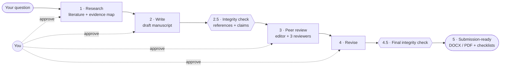

# Academic Research Skills — Respiratory Medicine Edition

An AI research assistant for **pulmonologists** who write papers. It runs inside **Codex** (desktop app or terminal). It finds and checks the literature, drafts the manuscript, reviews it like a journal would, and checks every reference before you submit.

It is tuned for **respiratory medicine in Romania**: GOLD 2026, ERS/ATS standards, Romanian ethics and data-protection rules (CTR/MDR routing, local ethics committees, GDPR, CNP), and Romanian and European venues.

> **You stay the author.** The assistant drafts and checks. You decide the question, the method and the conclusions. It stops and asks you at every stage.

---

## What it does for you

| You ask | You get |
|---|---|
| *"Research gap analysis on COPD exacerbations"* | A gap map: what is proven, what is missing, which study a Romanian centre could run first. [Example →](examples/copd-exacerbation-gap-analysis.md) |
| *"Systematic review of eosinophil-guided steroids in AECOPD"* | Protocol (PICO, search strings), screening with two blinded AI reviewers, PRISMA flow numbers |
| *"Write the paper for my retrospective cohort of 412 AECOPD admissions"* | IMRaD draft with STROBE/RECORD checklist, ethics and data-protection statements |
| *"Review my manuscript before I send it to ERJ Open Research"* | A simulated editor plus 3 reviewers plus a devil's advocate, with a revision plan |
| *"Check my references"* | Every citation checked against Crossref, OpenAlex, Semantic Scholar and arXiv; fabricated or wrong references flagged |

## How it works



You can start at any box. Already have a draft? Start at the integrity check. Got reviewer comments? Start at Revise. → [How it works, in detail](docs/HOW_IT_WORKS.md)

## Install (1 minute, once)

You need the **Codex** app or CLI, signed in with your ChatGPT account.

```bash
codex plugin marketplace add valinagacevschi/academic-research-skills
codex plugin add academic-research-skills@ars
```

That's it. The Romanian respiratory layer is **on by default** in every project. Open any folder as a project in Codex and type what you need. → [Setup details](docs/SETUP.md)

## What to type

Plain language works. To pick a tool directly, start with its name:

| Tool | Use it for | Example |
|---|---|---|
| `$deep-research` | Literature, gap analysis, systematic reviews, fact-checks | `$deep-research gap analysis: pulmonary rehab uptake after AECOPD in Romania` |
| `$sr-screener` | Screening search results for a systematic review | `$sr-screener screen these PubMed exports against my protocol` |
| `$academic-paper` | Drafting, abstracts, revision, citation formatting | `$academic-paper plan a paper on post-TB COPD exacerbations` |
| `$academic-paper-reviewer` | Pre-submission review | `$academic-paper-reviewer review this manuscript for Pneumologia` |
| `$academic-pipeline` | The whole path, question to submission | `$academic-pipeline full paper from my bronchiectasis registry data` |

## Patient data: the rules it follows

- **CNP or names pasted?** It stops, does not repeat them, asks you to redact, and offers to write analysis code you run locally instead.
- **Row-level data:** it warns once and continues only after you confirm your DPO allows it.
- **Aggregate data:** no restrictions.
- **Legal questions** (GDPR Art. 9, Law 190/2018, Law 46/2003) are framed as questions for your DPO and ethics committee, never as rulings.
- **Never** a consent waiver. Never a guess at which ethics route applies; it asks you.

## Does it work? How we test it

Every change is checked automatically, and the respiratory layer is tested with realistic doctor requests. → [Evaluation, in detail](docs/EVALUATION.md)

| Check | Result |
|---|---|
| Automated test suite | 9,571 tests passing |
| Respiratory facts (thresholds, MCIDs, legal provisions) | 112 values verified against primary sources, each with URL, quote and date |
| Doctor-scenario tests (ethics routing, pasted CNP, GOLD edition, venue limits…) | 6 of 6 passed through the installed plugin (11 Oct 2026) |
| Peer-review quality vs. real reviewers | **Not yet measured** |

What it **cannot** do: confirm your data are real, that procedures happened, or that results replicate. A well-written fabrication can pass. It reduces errors; it does not certify a paper.

## License

[CC BY-NC 4.0](LICENSE): free for non-commercial use with attribution. Based on [Academic Research Skills](https://github.com/Imbad0202/academic-research-skills) by Cheng-I Wu.
