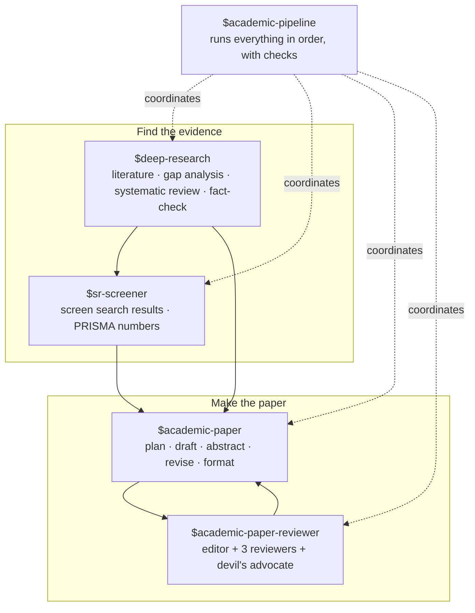
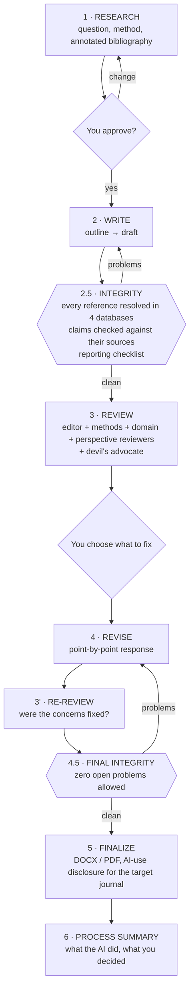
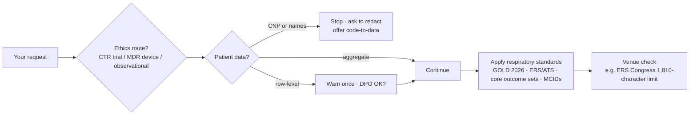
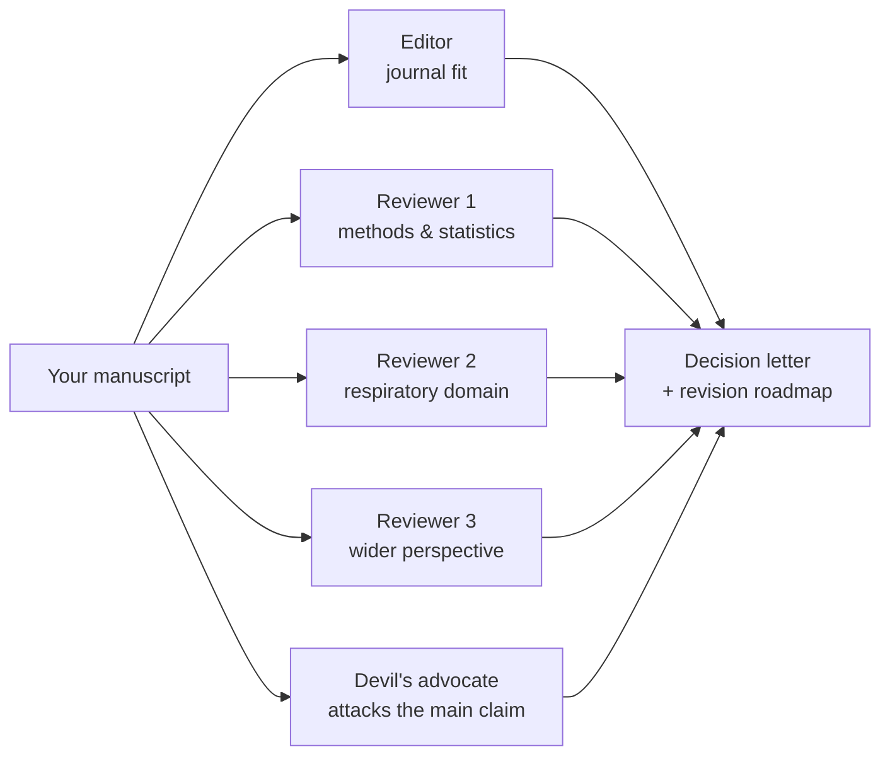

# How it works

Five tools, one pipeline, one Romanian respiratory layer on top. This page explains what happens at each step and where you are asked to decide.

## The five tools

| Tool | Typical respiratory use | Main output |
|---|---|---|
| `$deep-research` | "What do we know about RSV vaccination to prevent AECOPD?" | Evidence summary or gap map with citations |
| `$sr-screener` | Screen 2,300 PubMed/Embase records for a review of biologics in COPD | Include/exclude log, conflicts adjudicated, PRISMA 2020 counts |
| `$academic-paper` | Draft the paper from your cohort results | IMRaD manuscript, abstract, cover letter, DOCX/PDF |
| `$academic-paper-reviewer` | Pre-submission check before ERJ Open Research | 5 review reports and a revision plan |
| `$academic-pipeline` | The whole path, from question to submission | All of the above, with integrity checks between stages |

## The full pipeline

**Where you can start:**

| You have | Start at |
|---|---|
| Only a question | 1 · Research |
| A draft manuscript | 2.5 · Integrity check |
| Reviewer comments from a journal | 4 · Revise |

**The integrity checks (2.5 and 4.5) cannot be skipped silently.** If you override one, your reason is recorded in the process summary.

## What the Romanian respiratory layer adds

The layer is **on by default**: each tool reads its instructions before the first reply. They change four things:

1. **Ethics and law first.** It asks which route applies (EU CTR trial, MDR device investigation, or observational study) and which local ethics committee is responsible. It never offers a consent waiver. GDPR and Romanian law points come back as questions for your DPO.
2. **Patient-data tiers.** It stops on CNPs and names, warns on row-level data, and continues freely on aggregates.
3. **Verified respiratory facts.** Thresholds, MCIDs, guideline editions and legal provisions come from a table of **112 values checked against primary sources** (URL, verbatim quote, date). If a value is not in the table, it says "not verified" instead of guessing. Covered areas: airways (COPD, asthma, bronchiectasis, CF, AATD, chronic cough), ILD, pulmonary vascular disease, sleep, thoracic oncology, infection and TB.
4. **Venues.** Notes for Romanian and European journals and congresses. It shows them as "check the current author instructions" and never fills in limits you have not confirmed.

Everything it writes is in **English**. You can talk to it in Romanian.

## How the AI reviewers work

The reviewers run as separate Codex subagents and do not see each other's reports. If subagents are unavailable, one session plays each role in turn, and the report says independence was reduced. The devil's advocate only backs down if your rebuttal actually answers its point with evidence.

## Optional: a second AI checks the first

You can ask a **different AI family** (Anthropic Claude or Google Gemini) to independently re-check references and claims. It is off by default and needs your own API key. See [Setup](SETUP.md#optional-second-model-verification).
